# PayBridge — Multi-Currency Payment Gateway Aggregator (Demo)

> **Educational prototype (PST_PD_045 · FinTech · Level 4).**
> PayBridge **simulates** payments. It never connects to Stripe, Razorpay or any bank, never collects card details, and never moves money. Exchange rates are either **live reference rates** (European Central Bank and fallbacks, clearly labelled, not executable quotes) or an **illustrative demo table**; you can switch between them.

**Live demo:** <https://johithkrishn.github.io/Multi-Currency-Payment-Gateway-Aggregator/> (Checkout · [History](https://johithkrishn.github.io/Multi-Currency-Payment-Gateway-Aggregator/history.html) · [FX & Settings](https://johithkrishn.github.io/Multi-Currency-Payment-Gateway-Aggregator/settings.html) · [Tour](https://johithkrishn.github.io/Multi-Currency-Payment-Gateway-Aggregator/tour.html))

A merchant enters an amount, picks source and target currencies (USD, INR, EUR), reads the live (or demo) exchange rate, compares two mock providers, and runs a simulated payment that ends in success or failure. Every attempt is saved as a read-only snapshot in the browser so an operations analyst can filter, inspect, chart and export it later. A React Native companion app (Expo Go) shows the same checkout in a mobile bottom sheet, and its numbers are identical to the web app's.

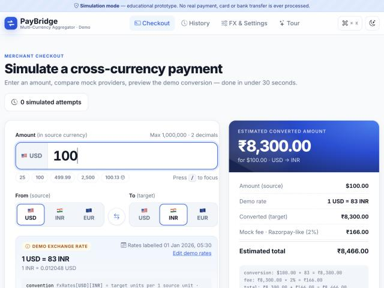

## Screenshots

### Web: checkout and payment flow
| Live reference rate and providers | Review | Payment pipeline |
|---|---|---|
| 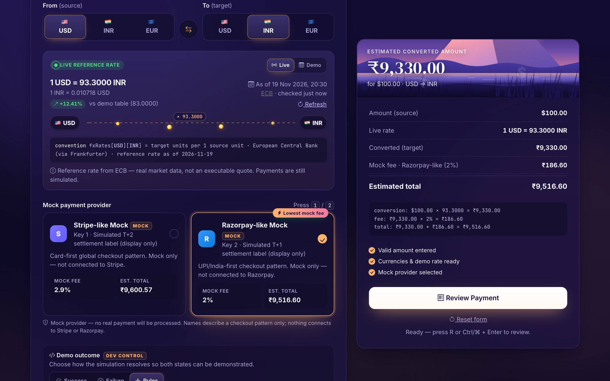 | 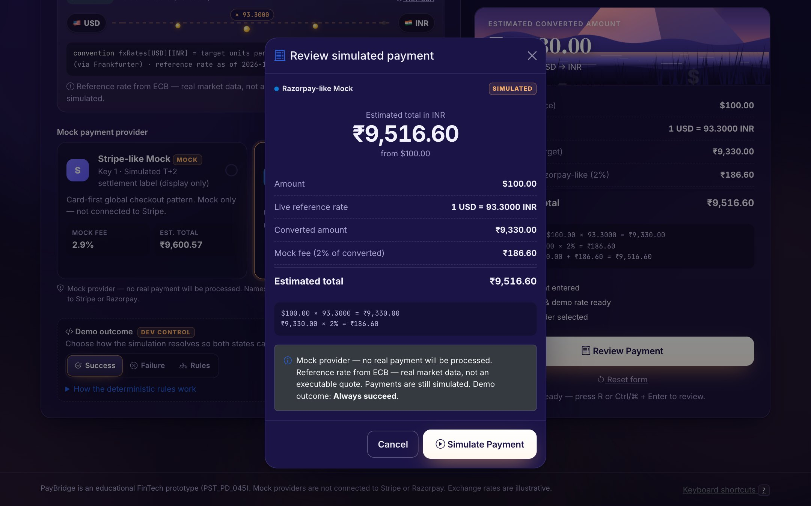 | 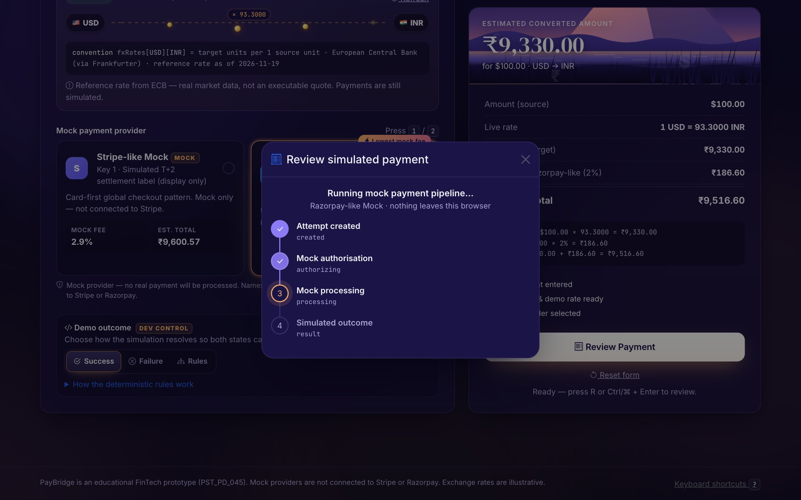 |

| Simulated success | Simulated failure (rule R1) | Phone width (390 px) |
|---|---|---|
| 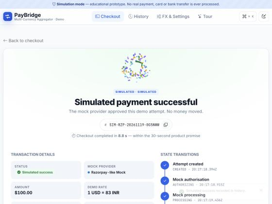 | 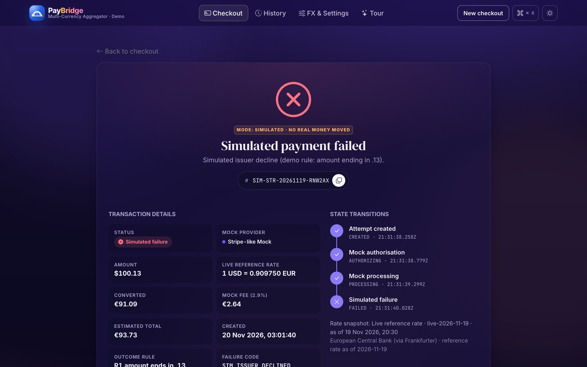 | 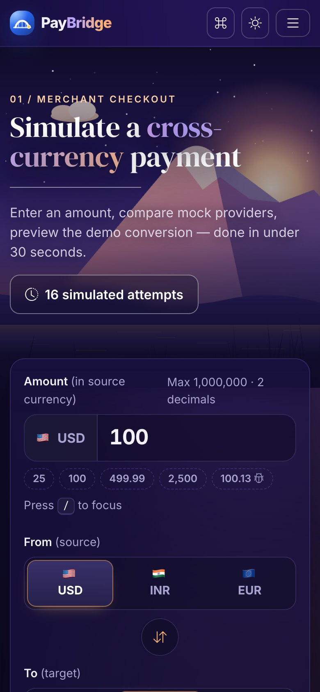 |

### Web: history and settings
| History and analytics | Filters and records | Transaction details |
|---|---|---|
| 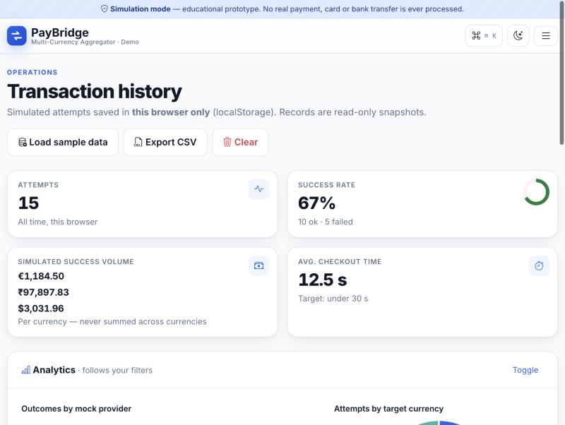 | 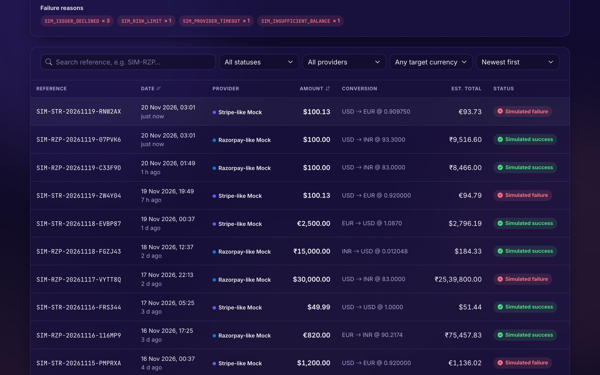 | 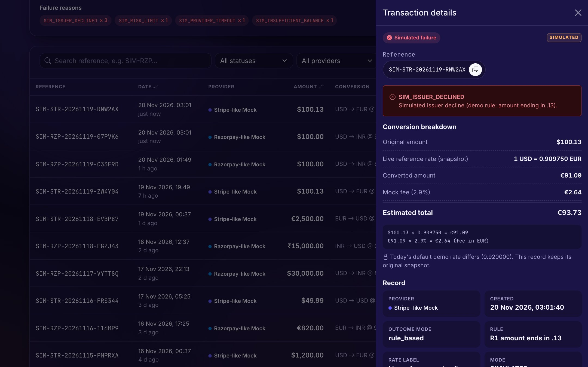 |

| Exchange-rate source (live vs demo) | Demo rate matrix and settings |
|---|---|
| 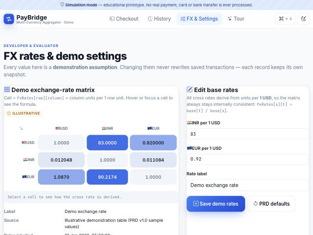 | 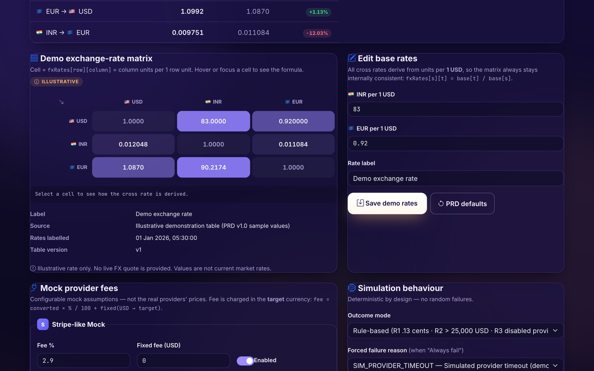 |

### Web: product tour
| Hero | Clarity | Harmony |
|---|---|---|
| 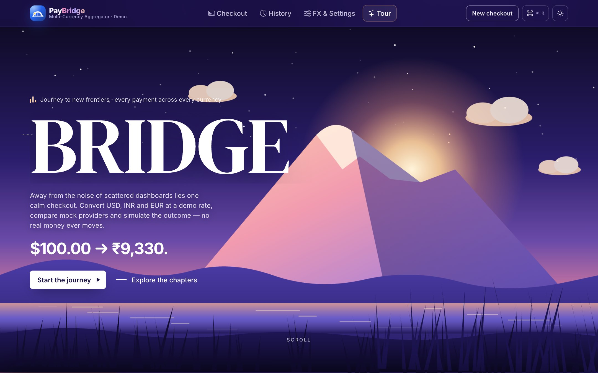 |  |  |

| Certainty | How a payment flows |
|---|---|
|  | 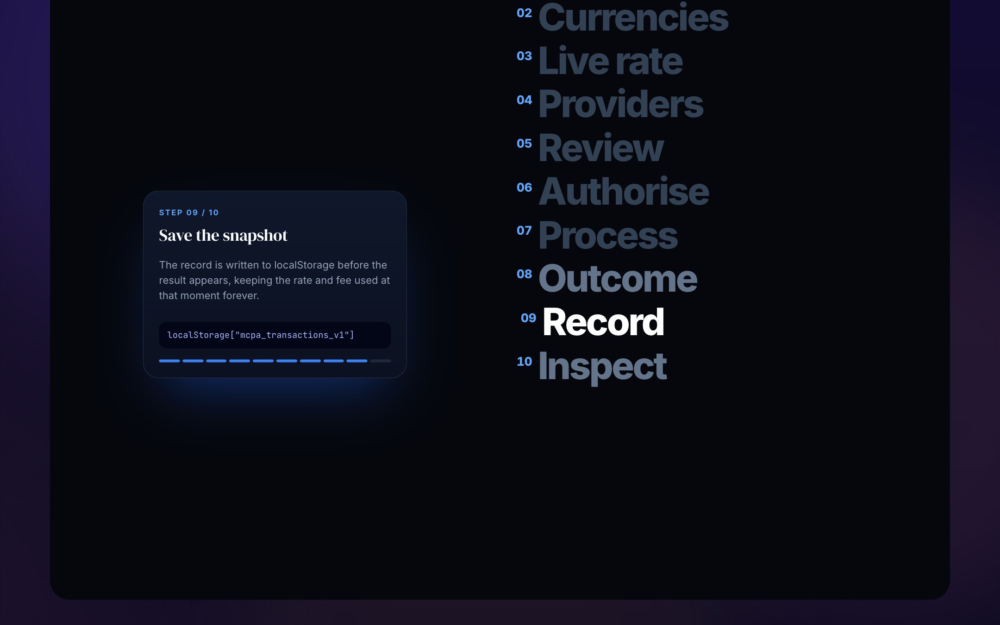 |

### Mobile companion (Expo)
| Checkout | Live rate card | Review bottom sheet | Result |
|---|---|---|---|
| 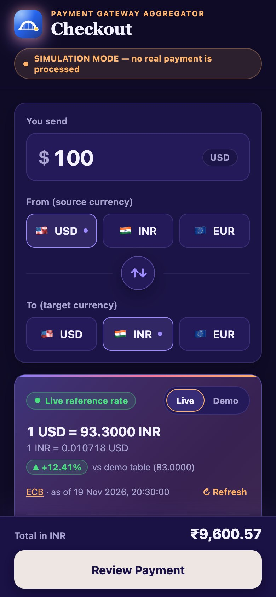 | 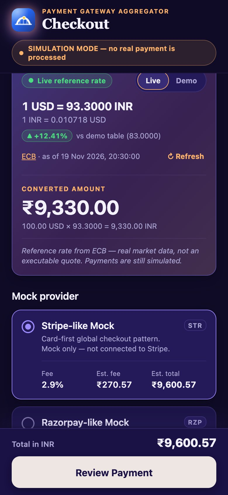 | 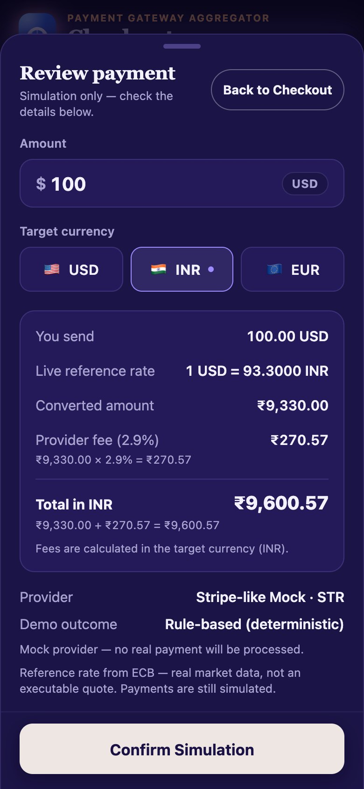 | 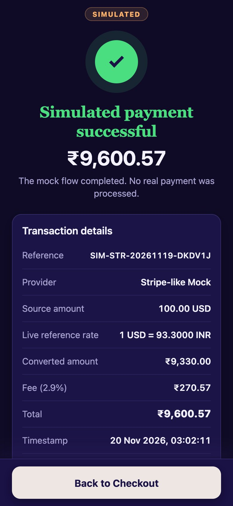 |

Screenshots were captured with headless Chrome against the running app: desktop at 1440×900 (1.5× scale), phone at 390×844 (2× scale).

---

## Quick start

| What | Command |
|---|---|
| **Web app** (no build, no install) | Open `web/index.html` in a browser, **or** run `npm start` and go to <http://localhost:5960> |
| **Tests** (Node ≥ 20, no dependencies) | `npm test` |
| **Python FX helper** (optional) | `python3 tools/fx_helper.py 100 USD INR --provider stripe_mock` · `npm run fx` |
| **Mobile app** (Node ≥ 22.13) | `cd mobile && npm install && npx expo start`, then scan the QR code with Expo Go. See [mobile/README.md](mobile/README.md) |

## Tech stack (as specified by the PRD, §14)

| Area | Technology |
|---|---|
| Web structure / styling | HTML5, CSS3 (custom design tokens on top of Bootstrap) |
| Web UI | **Bootstrap 5.3** (grid, cards, modal, offcanvas, collapse, toasts) + Bootstrap Icons |
| Web logic | **Vanilla JavaScript**, with no framework and no build step |
| Persistence | **localStorage** (`mcpa_transactions_v1`, `mcpa_fx_rates_v1`, `mcpa_settings_v1`) |
| Charts (optional extension) | Chart.js 4 |
| Mobile | **React Native + Expo Go** (SDK 58), JavaScript/JSX |
| Optional utility | **Python 3** standard library ([tools/fx_helper.py](tools/fx_helper.py)) |
| Dev tooling | Node's built-in test runner and a tiny static server. The app itself needs no backend. |

## Features

### Web screens (PRD §8)
- **Checkout / Home** (`index.html`)
  - **Amount:** amount field with live validation and quick-amount chips.
  - **Currencies:** segmented USD/INR/EUR pickers for source and target, plus an animated **swap** button.
  - **Rate panel:** a **Live / Demo** switch, the active rate in both directions with its label, source, "as of" time and difference from the demo table, and the `fxRates[source][target]` convention.
  - **Providers:** side-by-side mock provider cards with the live fee and total for the current amount, and a *Lowest mock fee* badge on the cheaper one.
  - **Summary:** a sticky summary card with a number that counts up, the fee breakdown, the formula behind it, and a readiness checklist.
- **Payment Review**: an accessible Bootstrap modal with the full summary. **Simulate Payment** runs an animated state machine (`CREATED → AUTHORIZING → PROCESSING → SUCCESS | FAILED`).
- **Payment Result** (`index.html#result=<ref>`):
  - an animated check or cross icon, labelled as simulated
  - a unique reference with a copy button
  - full details and the state timeline with timestamps
  - a **"completed in N s"** timer, which measures the PRD's under-30-seconds promise
  - Retry, Return to checkout, View history, Copy summary and Print receipt (prints with a SIMULATION watermark)
- **Transaction History** (`history.html`):
  - **KPIs:** attempts, success-rate ring, success volume per currency (never summed across currencies), and average checkout time.
  - **Charts:** outcomes by provider and attempts by target currency.
  - **Failure reasons:** a breakdown chip for each failure code.
  - **Finding records:** search by reference; filter by status, provider and currency; sort by date or amount; 10 records per page. Filters are kept in the URL so a view can be shared.
  - **Small screens:** the table switches to cards.
  - **Data:** CSV export (guarded against spreadsheet formula injection), sample data, and a confirmed clear.
- **Transaction Details**: an offcanvas drawer with the conversion breakdown, rate snapshot, timeline, and copy-summary / copy-JSON buttons. It is deep-linkable as `history.html#txn=<ref>` and never changes the record.
- **FX Rate Reference + Demo Settings** (`settings.html`):
  - **Rate matrix:** a heat-mapped matrix that shows the formula for a cell on hover or focus and can be navigated with the arrow keys.
  - **Base-rate editor:** live preview, and each save bumps the version.
  - **Provider settings:** fee and enabled toggles for each provider.
  - **Simulation settings:** outcome mode, forced failure reason, latency and theme.
  - **Storage:** diagnostics and guarded resets.
- **Tour** (`tour.html`):
  - a masked headline reveal and a typing line that writes out real demo conversions
  - glass bubbles that follow the cursor, with a magnetic **Play tour** orb
  - a scrolling ticker of demo rates
  - a scroll-highlighted word list that drives a sticky explainer screen
  - a draggable card slider with prev/next buttons and a progress bar

### Interaction layer
- **Logo:** a suspension bridge with a gold coin crossing it, drawn and animated in SVG on both web and mobile. A one-second logo intro plays once per browser session; click or press any key to skip it.
- **Motion layer** (`web/js/motion.js`):
  - pages slide in when you open them (cross-page transitions in browsers that support them)
  - a scroll progress bar, a soft glow that trails the cursor, and a slowly drifting background
  - a highlight pill that slides between nav links
  - cards tilt toward the cursor, and buttons ripple when clicked
  - checkout: coins flow between the two currencies (more coins for bigger amounts), the currency pickers visibly trade places on swap, provider cards pop when picked, and summary numbers bump when they change
  - results, history rows, KPI cards and the rate matrix animate in one after another
- **Glow buttons and cards:** a soft light follows the cursor inside primary buttons and provider cards. Buttons sit dimmed at rest and press in when clicked.
- **Command palette** (`Ctrl/⌘ K`) on every page: navigation, demo scenarios (for example "100.13 USD → EUR, rule R1 failure"), outcome-mode switches, filters, export and theme.
- **Keyboard shortcuts** (press `?`):
  - `/` focuses the amount field
  - `S` swaps currencies
  - `1` / `2` select a provider
  - `R` or `Ctrl/⌘ Enter` opens the review
  - `g` then `c`, `h`, `s` or `t` switches page
  - on History: `e` exports and `←` / `→` change page
- **Shareable deep links**: `index.html?amount=100&from=USD&to=INR&provider=razorpay_mock`.
- **Live cross-tab sync**: a payment simulated in one tab appears straight away in an open History tab.
- **Dusk theme** by default, inspired by an illustrated night-landscape site:
  - **Colours:** an indigo-violet night sky with sunset peach and rose highlights, lavender accents and glass cards.
  - **Type and controls:** large serif headlines (DM Serif Display), numbered eyebrows ("01 / Merchant checkout"), cream "Start the journey ▸" buttons and "— Learn more" links.
  - **Scenes** (`web/js/scene.js`): Checkout, History and Settings each open on a layered SVG landscape (glowing peak, waterfall with light rays, flowers and fireflies). Birds fly, water falls, grass sways, stars twinkle, and the layers move in parallax with the cursor and scroll.
  - **Tour:** a full-screen "BRIDGE" hero, then stacked scrolling chapters ("Clarity", "Harmony", "Certainty").
  - **Day theme:** the toggle switches to the light PRD palette. The mobile app uses the same Dusk palette.
  - **Reduced motion:** every animation respects `prefers-reduced-motion`.

### Mobile companion (PRD §6.3)
Two screens (Checkout and Payment result) plus a checkout **bottom sheet**:
- Opening and closing: a drag handle, a visible "Back to Checkout" button, tapping the backdrop, or the Android back button. Closing never submits.
- Inside the sheet: changing the target currency updates the preview immediately, and there is validation and a "Confirm Simulation" button.

Details are in [mobile/README.md](mobile/README.md).

## Calculation rules

```
fxRates[source][target] = target units received for ONE source unit
convertedAmount = amount × fxRates[source][target]
feeAmount       = convertedAmount × feePercent / 100 + feeFixed(USD) × fxRates[USD][target]
estimatedTotal  = round(convertedAmount) + round(feeAmount)      // all in the TARGET currency
```

- **Rate source: Live or Demo.** You can switch it on the checkout rate panel, in Settings, or from the command palette.
  - **Live** is the default. It fetches real reference rates in the browser (`web/js/live-rates.js`) from three keyless sources, trying them in this order:
    1. **European Central Bank** via [Frankfurter](https://frankfurter.dev)
    2. [ExchangeRate-API open access](https://www.exchangerate-api.com)
    3. [currency-api](https://github.com/fawazahmed0/exchange-api)
  - **Refresh and storage:** rates are re-checked every 5 minutes and when the tab comes back into view, and you can press **Refresh**. They are saved in `mcpa_live_rates_v1` and stop being used after 7 days.
  - **What the panel shows:** a pulsing "Live reference rate" badge, the source, the "as of" date, when it was last checked, and how far the live rate is from the demo table (for example +12.41%).
  - **Data checks:** each payload is validated, and values outside sanity limits are rejected.
  - **Fallback:** if every source fails, checkout uses the last saved live snapshot. If there isn't one, it uses the demo table and labels it "Demo exchange rate · live unavailable".
  - **Why not tick-by-tick:** reference rates are published once per business day. Second-by-second FX prices need a paid, keyed feed, which the PRD rules out.
- **Demo base rates** (PRD §10.1 sample values): 1 USD = 83.0 INR = 0.92 EUR. Every cross rate is derived as `base[t] / base[s]`, so the table is always internally consistent. Same-currency conversion is exactly 1.
- **Fees** are mock assumptions: Stripe-like 2.9%, Razorpay-like 2.0%, both configurable. They are always charged and shown in the **target** currency, and currencies are never mixed in a total.
- **Precision:** full precision is kept internally. Values are rounded half-up to 2 decimals only for display, and the total is the sum of the rounded parts so the breakdown always adds up.
- **Validation:** an amount must be from 0.01 to 1,000,000 with at most 2 decimals. Commas are accepted only as digit-group separators (`1,000` or `1,00,000`). Inputs like `12,34` are rejected rather than misread as 1234.

All of this lives in **one shared module**, [web/js/currency.js](web/js/currency.js), together with [payment-simulator.js](web/js/payment-simulator.js). The mobile app uses byte-identical copies, synced with `npm run sync-core`.

## Simulated outcomes (deterministic, PRD §10.6)

| Mode | Behaviour |
|---|---|
| **Rules** (default) | **R1:** cents exactly `.13` → *Simulated issuer decline* · **R2:** more than 25,000 USD-equivalent → *Simulated risk-limit decline* · **R3:** provider disabled → *Simulated provider unavailable* · otherwise success |
| **Success** | Always "Simulated payment successful" |
| **Failure** | Always "Simulated payment failed", using the reason chosen in Settings |

There are no random failures. The record is **saved before** the result is shown, and every record keeps its own rate and fee snapshot, so editing the demo rates later never rewrites history.

## Project structure

```
multi-currency-payment-aggregator/
├── web/                         ← deployable static site (GitHub Pages / Vercel root)
│   ├── index.html               Checkout · Review modal · Result
│   ├── history.html             History · Details drawer · Analytics
│   ├── settings.html            FX rate reference · Demo settings
│   ├── tour.html                Interactive product tour
│   ├── css/styles.css           Design tokens (PRD palette), components, motion
│   ├── js/currency.js           Shared: rates, rounding, formatting, validation, fees, quote
│   ├── js/payment-simulator.js  Shared: outcome rules, references, state machine, snapshots
│   ├── js/live-rates.js         Live reference rates: ECB → fallbacks, validation, cache
│   ├── js/scene.js · motion.js  Illustrated parallax scenes · motion layer
│   ├── js/storage.js            StorageService (safe, versioned localStorage)
│   ├── js/ui.js                 Navbar, toasts, palette, shortcuts, theme, effects
│   ├── js/app.js · history.js · settings.js · tour.js   page controllers
│   └── data/fx-rates.json       Documented demo rate dataset
├── mobile/                      React Native + Expo Go companion (2 screens + bottom sheet)
├── tests/
│   ├── conversion-cases.json    Shared fixtures (web = mobile = Python)
│   ├── conversion-cases.md      Human-readable test cases + PRD checklist mapping
│   ├── core.test.js             67 calculation/simulation tests (node --test)
│   └── live-rates.test.js       8 offline tests for live-rate parsing, validation and caching
├── tools/
│   ├── fx_helper.py             Optional Python 3 conversion helper + fixture checker
│   ├── serve.mjs                Zero-dependency local static server
│   └── sync-core.mjs            Copies the shared core into mobile/
├── docs/sample-transactions.json  Example simulated success + failure records
├── screenshots/
└── package.json
```

## Testing

```bash
npm test
```

This runs **75 tests**. The live-rate tests use recorded payloads, so no network is needed. The same calculation fixtures go through the web core, the mobile core and the Python helper:
- 12 conversion cases across every currency pair, including same-currency, minimum and maximum amounts
- 20 validation inputs
- 10 outcome cases
- rounding, formatting (including Indian digit grouping) and fixed-fee conversion
- 3,000 generated references with no duplicates
- snapshot immutability, the order of the state machine, and a check that the mobile copies are byte-identical to the web core

See [tests/conversion-cases.md](tests/conversion-cases.md) for the full table and how it maps to the PRD §17.2 checklist.

**Manual checks done in the browser while building:**
- the full checkout with both outcomes
- history persistence after a refresh, filters, sample data and charts
- settings: matrix, editor and resets
- the tour page effects
- no horizontal overflow at a 320 px viewport
- the mobile web build: checkout, sheet, currency change and result

**Still to do on real hardware:** run the mobile app in Expo Go on a physical phone and fill in the checklist in [mobile/README.md](mobile/README.md). This covers drag-to-dismiss, the Android back button, the keyboard and safe areas.

## Deployment

The web app is a static site in `web/` with no build step.
- **Vercel:** import the repo and set **Root Directory = `web`**.
- **GitHub Pages (live):** the site is served from the `gh-pages` branch, which holds only the contents of `web/`. After changing anything in `web/` and committing to `main`, redeploy with:
  ```bash
  git push origin "$(git subtree split --prefix web main)":refs/heads/gh-pages
  ```
  Pages rebuilds in about a minute.

## Limitations (by design)

- **No real payments.** There are no provider SDKs or APIs, no card or bank fields, and no settlement, refunds or compliance (PCI DSS, tax, cross-border). The provider names describe a checkout *pattern* only.
- **Reference rates, not quotes.** Live mode shows published reference rates, updated once per business day, which no provider will execute. Demo mode shows illustrative values. Either way the rate is snapshotted into each record, and no real payment happens. The mobile companion uses the same Live/Demo sources; its live snapshot is kept in memory for the app session only.
- **Browser-local history.** localStorage is per browser and per device, can be cleared by the user, and is not secure storage. Corrupt data is backed up and recovered safely. If storage is unavailable, a simulated attempt is held in memory on the current page and the result warns that it will not appear in the separate history page or survive leaving or reloading that page.
- **Mobile history** is held in memory for the current app session only and is not shared with the web app.
- No authentication, merchant accounts or multi-user permissions (out of scope per PRD §6.5).

## Accessibility

- **Forms and dialogs:** semantic HTML with labelled fields, fieldsets and legends; Bootstrap modal and offcanvas dialogs with focus management.
- **Keyboard:** visible focus rings, a skip link, and keyboard access to everything, including the rate matrix and the slider.
- **Screen readers:** live regions announce validation messages, pipeline steps and results.
- **Status and contrast:** status is always shown as text plus an icon, never by colour alone, and the palette targets WCAG AA.
- **Motion:** reduced-motion preferences are respected.

## Contribution summary (to be completed by the team)

| Student | Implementation areas | Learning outcomes |
|---|---|---|
| Jonnagadla Johith Krishn (PST-26-0124) | | |
| Chirra Balaji Yaswanth Reddy (PST-26-0084) | | |
